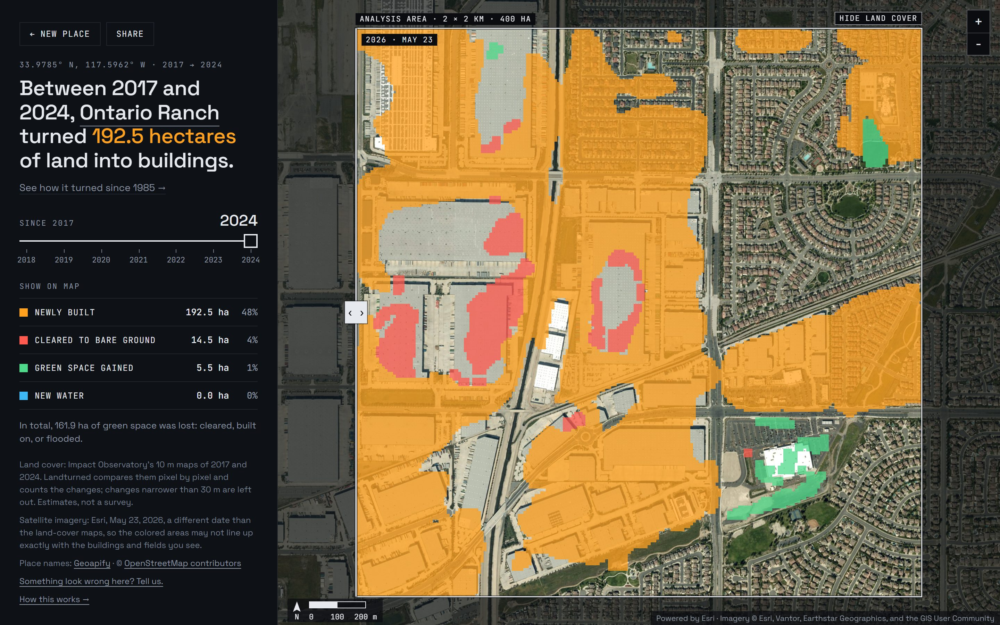
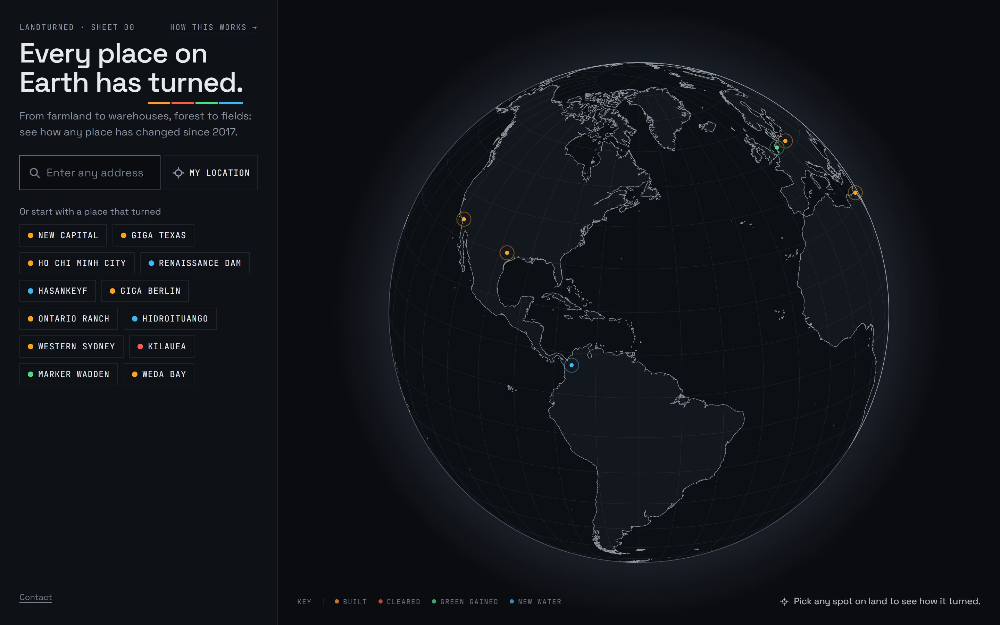
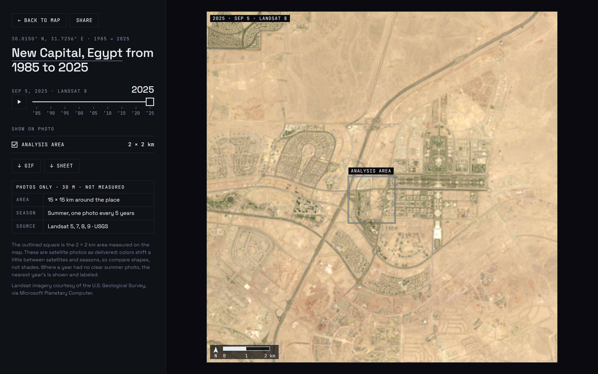
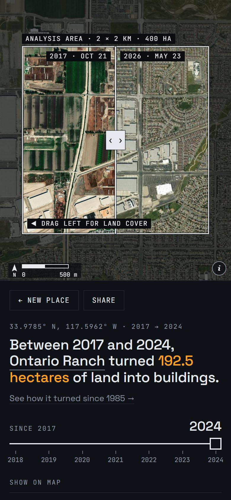

# Landturned

**See how the land around any address on Earth has turned:** newly built, cleared, greened or flooded, measured from satellite-based land-cover maps, with photos reaching back to 1985.

**Live:** https://landturned.com · **Method:** https://landturned.com/how/



Type an address, pick one of the glowing places on the globe, or use your location. Landturned turns to that spot, compares two years of land cover across a 2 × 2 km square, and answers in one plain sentence, such as *"Between 2017 and 2024, Ontario Ranch turned 192.5 hectares of land into buildings."*

## What you see

- **A globe to start from.** A slowly spinning linework globe (D3, orthographic projection) with twelve verified hotspots of dramatic land change, each colored by its kind of change.
- **The result, drawn like a site plan.** A satellite map of the 2 × 2 km square with:
  - a before/after swipe
  - a year slider
  - four change colors:

    | Color | Meaning |
    |---|---|
    | Red | Green space cleared |
    | Green | Green space gained |
    | Orange | Newly built |
    | Blue | New water |

  - the planning-drawing kit: a title block, scale bar and north arrow
  - stats in hectares, describing exactly the square on screen
- **The long view, since 1985.** Nine summer Landsat photos of the 15 × 15 km around the place, one about every five years. They play like a flipbook, with the analysis square outlined. These are photos only, not measurements, and the view says so.
- **Sharing.** Every result and long view has its own link with a preview card. The long view also downloads as an animated GIF or a contact sheet.





<p align="center"></p>

## How change is measured

Landturned does **not** classify satellite imagery itself. It compares published, pre-classified global land-cover maps:

1. Read the 2 × 2 km square (200 × 200 pixels of 10 m) from [Impact Observatory's](https://www.impactobservatory.com/) annual land-cover maps for two years.
2. Merge their nine classes into five: trees, grass/farmland, built, water, bare (plus no data).
3. Compare each pixel's label between the years and give each changed pixel one color.
4. Clean the edges: changes narrower than about 30 m are removed with a morphological opening, because a pixel straddling a road or shoreline can flip labels when nothing changed.
5. Count the pixels. Each one is 0.01 ha.

The results are **estimates**, and the app says so. Label errors, fuzzy edges, clouds and the 10 m pixel size all limit them. The [method page](https://landturned.com/how/) walks through each step with real pixels.

## Data

| Use | Source | Years | Pixel size |
|---|---|---|---|
| Measured change | Impact Observatory annual land use/land cover (AWS Open Data, `io-10m-annual-lulc`) | 2017 to latest | 10 m |
| Before/after photos | Esri World Imagery and its Wayback archive | about 2014 to now | under 1 m |
| Long view photos | Landsat 5, 7, 8 and 9 Collection 2 Level-2 (USGS, via Microsoft Planetary Computer) | 1985 to now | 30 m |
| Place names | Geoapify, from OpenStreetMap data | — | — |

**Long view rules:**
- Landsat photos are shown as delivered, with one fixed color stretch.
- Landsat 7 is used only before its 2003 sensor fault.
- Landsat is never mixed with Esri imagery in the same view.

## Design decisions worth noting

- **A fixed square, not a radius.** The stats describe exactly what you see when you swipe, like a site boundary on a plan.
- **Grid-up map.** The square comes from the UTM grid, which is turned slightly from true north. The map is rotated so the square sits straight, and the north arrow turns with it.
- **Honest progress.** The loading steps follow real events (globe turn finished, map tiles loaded, analysis returned), never fake timers.
- **Real years in every sentence.** The result says "between 2017 and 2024", never "since 2017", because the data stops at its latest year.
- **Hotspots are verified, not picked by eye.** A script runs the app's own analysis around each candidate place and moves the square onto the change. Places whose "change" is a classification error are rejected.

## Built with

- **Frontend:** plain JavaScript, [Vite](https://vite.dev/), [MapLibre GL JS](https://maplibre.org/), [D3](https://d3js.org/)
- **Backend:** Python 3.13, [FastAPI](https://fastapi.tiangolo.com/), [rasterio](https://rasterio.readthedocs.io/), NumPy, Pillow, [uv](https://docs.astral.sh/uv/)
- **Hosting:** [Render](https://render.com/), with a disk cache so repeat places answer instantly

## Run it locally

You need [Node.js](https://nodejs.org/) and [uv](https://docs.astral.sh/uv/).

```sh
# Backend (http://localhost:8000)
cd backend
echo "GEOAPIFY_API_KEY=your-key" > .env   # free key from geoapify.com, for place names
uv sync
uv run uvicorn app.main:app --reload

# Frontend (https://localhost:5173, forwards /api to the backend)
cd frontend
npm install
npm run dev
```

The dev server uses a self-signed HTTPS certificate so phones on the same network can open it. Accept the browser's warning once.

## Project layout

```
backend/app/       API: analysis.py (change), landcover.py (reading the maps), wayback.py (Esri archive),
                   longview.py (Landsat photos), share.py (preview cards, GIF, sheet), main.py (routes)
backend/scripts/   rank_places.py (verifying hotspots), warm_*.py (pre-filling the cache)
frontend/src/      main.js (flow), globe.js, map.js, results.js, longview.js
frontend/how/      the method page
docs/STATUS.md     detailed build notes and decisions
DESIGN.md          the design system (drawing-sheet style)
```

## Credits

- Land cover: 10m Annual Land Use Land Cover by Impact Observatory, Microsoft and Esri, CC BY 4.0. Landturned simplifies its 9 classes into 5 and removes changes narrower than about 30 m.
- Imagery: Powered by Esri. World Imagery and Wayback: Esri, Vantor, Earthstar Geographics and the GIS User Community (older Wayback releases credit others too).
- Landsat imagery courtesy of the U.S. Geological Survey.
- Place names © OpenStreetMap contributors, via Geoapify.
- Fonts: Space Grotesk and JetBrains Mono (SIL Open Font License).
